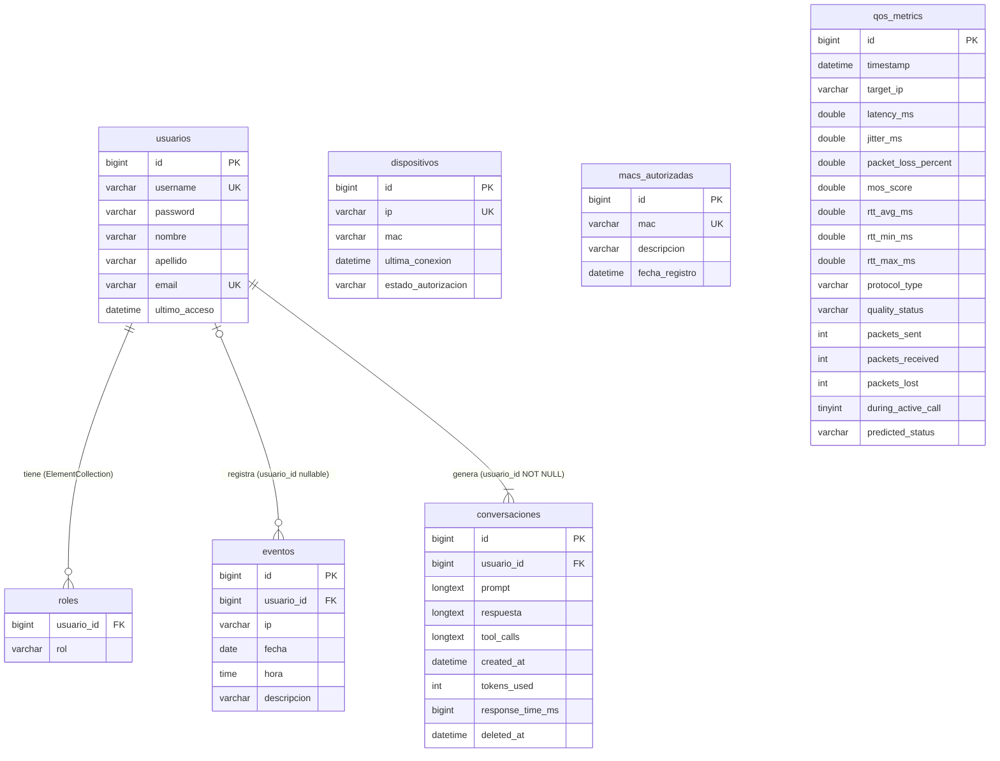
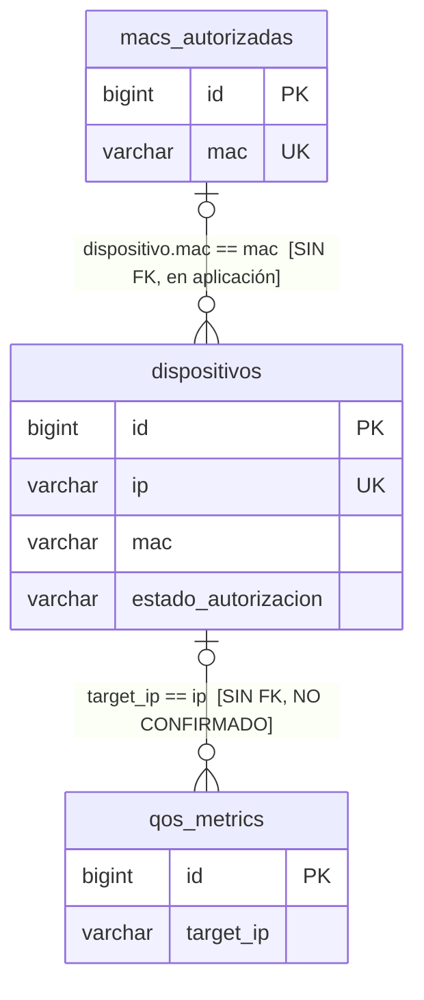

# Modelo Entidad-Relación (MER) — ShieldNet

> Documento técnico de trazabilidad. Todo lo que sigue se basa en evidencia verificable del
> repositorio. Donde no existe evidencia suficiente se indica explícitamente **No determinado**.
> Las propuestas aparecen únicamente en la sección 8, separadas del modelo real.

---

## 1. Resumen

ShieldNet persiste en **MySQL** mediante **Spring Data JPA / Hibernate** (`spring.jpa.hibernate.ddl-auto=update`),
por lo que **el esquema lo definen las anotaciones JPA de las entidades**, no un script de migración versionado.
No existen Flyway ni Liquibase en el proyecto; el único artefacto SQL de esquema es
`shieldnet-ml/migration.sql` (una `ALTER TABLE` manual para `qos_metrics.predicted_status`).

El modelo real está compuesto por:

- **6 entidades JPA** → 6 tablas: `usuarios`, `dispositivos`, `eventos`, `macs_autorizadas`,
  `qos_metrics`, `conversaciones`.
- **1 tabla de colección** generada por `@ElementCollection`: `roles` (no es una entidad JPA).
- **Total: 7 tablas**.
- **3 relaciones con clave foránea real** (todas desde `usuarios`): hacia `roles`, `eventos` y `conversaciones`.
- **Las otras tablas están aisladas**: `dispositivos`, `macs_autorizadas` y `qos_metrics`
  no tienen ninguna FK hacia el resto del modelo.

Existe además un conjunto de **relaciones lógicas** que se resuelven comparando cadenas en tiempo de
aplicación (MAC e IP), **sin integridad referencial**.

El modelo tiene **dos fuentes documentales previas que no coinciden entre sí ni con el código**:
`docs/DOCUMENTO_TECNICO_DESARROLLO_WEB_AVANZADO.md` (ER en ASCII) y `docs/diagrama-datos.png`.
Ambas se contrastan en las secciones 5, 8 y 10.

**Nivel de confianza del modelo: alto para entidades/atributos** (derivado directamente de anotaciones JPA),
**medio para restricciones de nivel de BD** (la conexión a la base de datos no estuvo disponible para
verificar el DDL real generado por Hibernate; ver §2).

---

## 2. Fuentes analizadas

### 2.1 Código (fuente de verdad primaria)

| Archivo                                                                                | Aporta                                                                         |
| -------------------------------------------------------------------------------------- | ------------------------------------------------------------------------------ |
| `src/main/java/com/example/security/modelo/Usuario.java`                               | Entidad `usuarios`, colección `roles`                                          |
| `src/main/java/com/example/security/modelo/Dispositivo.java`                           | Entidad `dispositivos`                                                         |
| `src/main/java/com/example/security/modelo/Evento.java`                                | Entidad `eventos` + FK a `usuarios`                                            |
| `src/main/java/com/example/security/modelo/MacAutorizada.java`                         | Entidad `macs_autorizadas`                                                     |
| `src/main/java/com/example/security/modelo/QoSMetrics.java`                            | Entidad `qos_metrics`                                                          |
| `src/main/java/com/example/security/modelo/Conversacion.java`                          | Entidad `conversaciones` + FK a `usuarios` + índice                            |
| `src/main/java/com/example/security/modelo/EstadoAutorizacion.java`                    | Dominio de `estado_autorizacion`                                               |
| `src/main/java/com/example/security/repositorio/*.java`                                | Consultas y criterios de acceso (6 repositorios)                               |
| `src/main/java/com/example/security/servicios/ArpScannerService.java`                  | Ingesta en `dispositivos`; comparación de MAC contra whitelist                 |
| `src/main/java/com/example/security/servicios/EventoService.java`                      | Ingesta en `eventos`; FK opcional a `usuarios`                                 |
| `src/main/java/com/example/security/servicios/QoSService.java`                         | Ingesta en `qos_metrics`; derivación de `quality_status` y `packets_lost`      |
| `src/main/java/com/example/security/servicios/QosPredictionService.java`               | Origen de `predicted_status` (microservicio ML)                                |
| `src/main/java/com/example/security/servicios/ChatService.java`                        | Ingesta/soft-delete en `conversaciones`                                        |
| `src/main/java/com/example/security/servicios/UserService.java`, `AuthController.java` | Valores de `roles.rol`                                                         |
| `src/main/java/com/example/security/servicios/ContextBuilder.java`                     | Descripción de esquema usada por la IA (contrastada)                           |
| `src/main/java/com/example/security/controller/OptimizacionDatosController.java`       | SQL nativo sobre `dispositivos`, `qos_metrics`, `eventos`                      |
| `src/main/java/com/example/security/dto/*.java`                                        | DTOs (contrastados frente a entidades)                                         |
| `src/main/java/com/example/security/config/SecurityConfig.java`                        | Cifrado BCrypt y nombres de rol                                                |
| `pom.xml`                                                                              | Spring Boot 3.4.4, JPA, MySQL Connector, ausencia de herramientas de migración |
| `src/main/resources/application.properties`                                            | Conector MySQL, `ddl-auto=update`                                              |

### 2.2 SQL / esquemas

| Archivo                                              | Aporta                                                                                     |
| ---------------------------------------------------- | ------------------------------------------------------------------------------------------ |
| `shieldnet-ml/migration.sql`                         | Único artefacto SQL de esquema: `ALTER TABLE qos_metrics ADD predicted_status VARCHAR(50)` |
| `Modelo Matematico/shieldnet_optimizacion.py`        | Consultas SQL nativas a `dispositivos`, `qos_metrics`, `eventos`                           |
| `shieldnet-ml/train_and_export.py`, `predict_api.py` | Origen del valor `predicted_status` (no leen la BD directamente)                           |

### 2.3 Documentación previa

| Archivo                                                            | Aporta                                                  |
| ------------------------------------------------------------------ | ------------------------------------------------------- |
| `docs/DOCUMENTO_TECNICO_DESARROLLO_WEB_AVANZADO.md` (§4.5 y §8)    | ER ASCII previo, tipos, relaciones declaradas           |
| `docs/diagrama-datos.png`                                          | Diagrama ER visual previo (difiere del código; ver §10) |
| `docs/diagrama-seguridad.png`, `docs/diagrama-integracion-llm.png` | Contexto de arquitectura                                |
| `GUION_EXPOSICION.md`                                              | Narrativa del proyecto                                  |
| `shieldnet-ml/README.md`                                           | Contrato del microservicio ML                           |
| `.env.example`, `application-chat.properties`                      | Parámetros de retención y herramientas                  |

### 2.4 Verificación sobre la base de datos en ejecución

Se intentó inspeccionar el esquema real mediante la conexión MCP configurada `mysql`
(`db_schema_connections`). Resultado:

```
status: unreachable — "Can't connect to MySQL server on 'host.docker.internal'"
```

**Consecuencia:** el DDL efectivamente generado por Hibernate (claves primarias de `roles`,
`ON DELETE CASCADE`, índices reales) **no pudo verificarse**. Todo lo que depende de ese DDL se marca
como **No determinado** en las tablas siguientes.

### 2.5 Skills y herramientas evaluadas

| Recurso                   | Evaluación                                                                                                                                                                   | Uso                                                                                                                                                                |
| ------------------------- | ---------------------------------------------------------------------------------------------------------------------------------------------------------------------------- | ------------------------------------------------------------------------------------------------------------------------------------------------------------------ |
| Skill `archify`           | Genera diagramas de arquitectura, workflow, sequence, dataflow y lifecycle. **No tiene tipo ERD** (`guide` devolvió `confidence: low`, recomendando un mapa de componentes). | **Usada**: `guide` recomienda `architecture` (`confidence: low`); no existe tipo ERD en la skill, por lo que cada tabla se modeló como componente `database` y cada relación como arista con su cardinalidad (§6.4). |
| Skill `database-design`   | Principios de diseño de esquema.                                                                                                                                             | Considerada para la evaluación de normalización (§7).                                                                                                              |
| Mermaid `erDiagram`       | Representación reproducible, sin dependencias, renderiza nativamente en GitHub (el proyecto ya está en GitHub: `docs/github-link.txt`).                                      | **Usada** como diagrama reproducible (§6).                                                                                                                         |
| Bloques ASCII `textplain` | Convención ya existente en `docs/DOCUMENTO_TECNICO_DESARROLLO_WEB_AVANZADO.md`.                                                                                              | **Usada** como diagrama textual (§6).                                                                                                                              |
| PlantUML / DBML           | No existen en el proyecto.                                                                                                                                                   | No usadas (evitar dependencias nuevas).                                                                                                                            |

---

## 3. Entidades

| Entidad (tabla)                                | Propósito                                             | PK                                | Estado                                   |
| ---------------------------------------------- | ----------------------------------------------------- | --------------------------------- | ---------------------------------------- |
| `usuarios`                                     | Cuentas de acceso autenticadas con roles              | `id`                              | Confirmado                               |
| `roles` *(tabla de colección, no entidad JPA)* | Roles asignados a cada usuario (`@ElementCollection`) | **No determinado** (ver §5 y §10) | Confirmado como tabla; PK no determinada |
| `dispositivos`                                 | Inventario de hosts detectados en la red por ARP      | `id`                              | Confirmado                               |
| `eventos`                                      | Bitácora de eventos de seguridad/operación            | `id`                              | Confirmado                               |
| `macs_autorizadas`                             | Lista blanca de direcciones MAC                       | `id`                              | Confirmado                               |
| `qos_metrics`                                  | Series temporales de métricas QoS y predicción ML     | `id`                              | Confirmado                               |
| `conversaciones`                               | Historial de conversaciones del chat IA (soft delete) | `id`                              | Confirmado                               |

**Entidades no persistentidas (excluidas del modelo):** `PingRequest`, `PingResponse`,
`PortScanRequest`, `PortScanResponse`, `Protocolo`, `QoSMetricsRequest`, `NetworkScanRequest`,
`ReportRequest`, `EventHistoryRequest` — son DTOs/pojos de petición sin `@Entity`
(estado: Confirmado que **no** forman parte del modelo).

---

## 4. Atributos

Tipos SQL derivados de la correspondencia JPA→MySQL y confirmados contra la documentación del
proyecto cuando esta lo declara. `AI` = autoincremental (`GenerationType.IDENTITY`).

| Entidad            | Atributo                    | Tipo (Java → SQL)                                                  |  PK   |       FK        |          Nullable          | Estado                                      |
| ------------------ | --------------------------- | ------------------------------------------------------------------ | :---: | :-------------: | :------------------------: | ------------------------------------------- |
| `usuarios`         | `id`                        | Long → bigint AI                                                   |   ✓   |                 |             no             | Confirmado                                  |
| `usuarios`         | `username`                  | String → varchar(255)                                              |       |                 |       no, **único**        | Confirmado                                  |
| `usuarios`         | `password`                  | String → varchar(255) (hash BCrypt)                                |       |                 |             no             | Confirmado                                  |
| `usuarios`         | `nombre`                    | String → varchar(255)                                              |       |                 |             no             | Confirmado                                  |
| `usuarios`         | `apellido`                  | String → varchar(255)                                              |       |                 |             no             | Confirmado                                  |
| `usuarios`         | `email`                     | String → varchar(255)                                              |       |                 |       no, **único**        | Confirmado                                  |
| `usuarios`         | `ultimo_acceso`             | LocalDateTime → datetime                                           |       |                 |             sí             | Confirmado                                  |
| `roles`            | `usuario_id`                | Long → bigint                                                      |       | → `usuarios.id` |             no             | Confirmado                                  |
| `roles`            | `rol`                       | String → varchar(255)                                              |       |                 |             no             | Confirmado                                  |
| `roles`            | `id` (declarado en docs)    | —                                                                  | ¿PK?  |                 |             —              | **No determinado** — no existe en el código |
| `dispositivos`     | `id`                        | Long → bigint AI                                                   |   ✓   |                 |             no             | Confirmado                                  |
| `dispositivos`     | `ip`                        | String → varchar(255)                                              |       |                 |       no, **único**        | Confirmado                                  |
| `dispositivos`     | `mac`                       | String → varchar(17)                                               |       |                 |             sí             | Confirmado                                  |
| `dispositivos`     | `ultima_conexion`           | java.util.Date → datetime                                          |       |                 |             sí             | Confirmado                                  |
| `dispositivos`     | `estado_autorizacion`       | String → varchar(20)                                               |       |                 |             sí             | Confirmado                                  |
| `dispositivos`     | `estadoAutorizacion` (enum) | `@Transient`                                                       |       |                 |             —              | Confirmado: **no persistido**               |
| `eventos`          | `id`                        | Long → bigint AI                                                   |   ✓   |                 |             no             | Confirmado                                  |
| `eventos`          | `ip`                        | String → varchar(255)                                              |       |                 |             no             | Confirmado                                  |
| `eventos`          | `fecha`                     | java.util.Date (`Temporal DATE`) → date                            |       |                 |             no             | Confirmado                                  |
| `eventos`          | `hora`                      | java.util.Date (`Temporal TIME`) → time                            |       |                 |             no             | Confirmado                                  |
| `eventos`          | `descripcion`               | String → varchar(255)                                              |       |                 |             sí             | Confirmado                                  |
| `eventos`          | `usuario_id`                | Long → bigint                                                      |       | → `usuarios.id` | **sí** (`nullable = true`) | Confirmado                                  |
| `macs_autorizadas` | `id`                        | Long → bigint AI                                                   |   ✓   |                 |             no             | Confirmado                                  |
| `macs_autorizadas` | `mac`                       | String → varchar(17)                                               |       |                 |       no, **único**        | Confirmado                                  |
| `macs_autorizadas` | `descripcion`               | String → varchar(255)                                              |       |                 |             sí             | Confirmado                                  |
| `macs_autorizadas` | `fecha_registro`            | java.util.Date → datetime                                          |       |                 |             sí             | Confirmado                                  |
| `qos_metrics`      | `id`                        | Long → bigint AI                                                   |   ✓   |                 |             no             | Confirmado                                  |
| `qos_metrics`      | `timestamp`                 | LocalDateTime → datetime                                           |       |                 |             sí             | Confirmado                                  |
| `qos_metrics`      | `target_ip`                 | String → varchar(255)                                              |       |                 |             sí             | Confirmado                                  |
| `qos_metrics`      | `latency_ms`                | Double → double                                                    |       |                 |             sí             | Confirmado                                  |
| `qos_metrics`      | `jitter_ms`                 | Double → double                                                    |       |                 |             sí             | Confirmado                                  |
| `qos_metrics`      | `packet_loss_percent`       | Double → double                                                    |       |                 |             sí             | Confirmado                                  |
| `qos_metrics`      | `mos_score`                 | Double → double                                                    |       |                 |             sí             | Confirmado                                  |
| `qos_metrics`      | `rtt_avg_ms`                | Double → double                                                    |       |                 |             sí             | Confirmado                                  |
| `qos_metrics`      | `rtt_min_ms`                | Double → double                                                    |       |                 |             sí             | Confirmado                                  |
| `qos_metrics`      | `rtt_max_ms`                | Double → double                                                    |       |                 |             sí             | Confirmado                                  |
| `qos_metrics`      | `protocol_type`             | String → varchar(255)                                              |       |                 |             sí             | Confirmado                                  |
| `qos_metrics`      | `quality_status`            | String → varchar(255)                                              |       |                 |             sí             | Confirmado                                  |
| `qos_metrics`      | `packets_sent`              | Integer → int                                                      |       |                 |             sí             | Confirmado                                  |
| `qos_metrics`      | `packets_received`          | Integer → int                                                      |       |                 |             sí             | Confirmado                                  |
| `qos_metrics`      | `packets_lost`              | Integer → int                                                      |       |                 |             sí             | Confirmado                                  |
| `qos_metrics`      | `during_active_call`        | Boolean → tinyint(1), default `false`                              |       |                 |             sí             | Confirmado                                  |
| `qos_metrics`      | `predicted_status`          | String → **varchar(50)**                                           |       |                 |             sí             | Confirmado (`migration.sql` + entidad)      |
| `conversaciones`   | `id`                        | Long → bigint AI                                                   |   ✓   |                 |             no             | Confirmado                                  |
| `conversaciones`   | `usuario_id`                | Long → bigint                                                      |       | → `usuarios.id` |           **no**           | Confirmado                                  |
| `conversaciones`   | `prompt`                    | String → **longtext**                                              |       |                 |             no             | Confirmado                                  |
| `conversaciones`   | `respuesta`                 | String → **longtext**                                              |       |                 |             no             | Confirmado                                  |
| `conversaciones`   | `tool_calls`                | String → longtext (JSON)                                           |       |                 |             sí             | Confirmado                                  |
| `conversaciones`   | `created_at`                | LocalDateTime → datetime (`@CreationTimestamp`, `updatable=false`) |       |                 |             no             | Confirmado                                  |
| `conversaciones`   | `tokens_used`               | Integer → int                                                      |       |                 |             sí             | Confirmado                                  |
| `conversaciones`   | `response_time_ms`          | Long → bigint                                                      |       |                 |             sí             | Confirmado                                  |
| `conversaciones`   | `deleted_at`                | LocalDateTime → datetime (soft delete)                             |       |                 |             sí             | Confirmado                                  |

### Claves candidatas (únicamente con evidencia de restricción `unique`)

| Entidad            | Atributo   | Restricción                                | Estado     |
| ------------------ | ---------- | ------------------------------------------ | ---------- |
| `usuarios`         | `username` | `@Column(unique = true, nullable = false)` | Confirmado |
| `usuarios`         | `email`    | `@Column(unique = true, nullable = false)` | Confirmado |
| `dispositivos`     | `ip`       | `@Column(nullable = false, unique = true)` | Confirmado |
| `macs_autorizadas` | `mac`      | `@Column(nullable = false, unique = true)` | Confirmado |

No se declara ninguna otra clave candidata. En particular, `qos_metrics (target_ip, timestamp)` es
una **combinación natural evidente** pero **no tiene restricción de unicidad** en el código:
**no se declara como clave candidata**.

---

## 5. Relaciones

### 5.1 Relaciones con clave foránea (implementadas)

| Entidad origen   | Relación       | Entidad destino | Cardinalidad | Opcionalidad                                                            | Evidencia                                       |
| ---------------- | -------------- | --------------- | :----------: | ----------------------------------------------------------------------- | ----------------------------------------------- |
| `roles`          | pertenece a    | `usuarios`      |     N:1      | Obligatoria en la práctica (`joinColumns` de `@CollectionTable`)        | `Usuario.java:43-46`                            |
| `eventos`        | registrado por | `usuarios`      |     N:1      | **Opcional** (`nullable = true`); eventos sin usuario = sistema/anónimo | `Evento.java:40-42`; `EventoService.java:54-58` |
| `conversaciones` | generada por   | `usuarios`      |     N:1      | **Obligatoria** (`nullable = false`)                                    | `Conversacion.java:22-24`                       |

Leído del lado inverso:

| Entidad origen | Relación | Entidad destino  | Cardinalidad | Opcionalidad                               |
| -------------- | -------- | ---------------- | :----------: | ------------------------------------------ |
| `usuarios`     | tiene    | `roles`          |     1:N      | Un usuario puede tener 0..N filas de rol   |
| `usuarios`     | genera   | `eventos`        |     1:N      | Un usuario puede tener 0..N eventos        |
| `usuarios`     | genera   | `conversaciones` |     1:N      | Un usuario puede tener 0..N conversaciones |

No existen relaciones 1:1 ni N:M con entidad asociativa en el modelo.

### 5.2 Relaciones lógicas sin clave foránea

| Entidad origen | Relación                        | Entidad destino    |          Cardinalidad           | Opcionalidad                                               | Evidencia                                                                                                                                        | Estado                                                                                                                                        |
| -------------- | ------------------------------- | ------------------ | :-----------------------------: | ---------------------------------------------------------- | ------------------------------------------------------------------------------------------------------------------------------------------------ | --------------------------------------------------------------------------------------------------------------------------------------------- |
| `dispositivos` | clasificado contra              | `macs_autorizadas` | N:1 (por valor de cadena `mac`) | Opcional: un dispositivo puede no estar en la lista blanca | `ArpScannerService.java:195-197` (`macAutorizadaService.esMacAutorizada`); `MacAutorizadaController.java:49` (`dispositivoRepository.findByMac`) | **Derivado** — se resuelve en aplicación, **sin FK**                                                                                          |
| `qos_metrics`  | corresponde a (por `target_ip`) | `dispositivos`     | N:1 (por valor de cadena `ip`)  | No determinable sin datos                                  | Uso semántico de `target_ip` como host monitorizado; `dispositivos.ip` es UNIQUE, por lo que una FK sería viable                                 | **No determinado** — `docs/DOCUMENTO_TECNICO…` §8.3 lo declara explícitamente *"QOS_METRICS → (ninguna) · Independiente"* → **contradicción** |
| `eventos`      | corresponde a (por `ip`)        | `dispositivos`     | N:1 (por valor de cadena `ip`)  | No determinable                                            | **Sin evidencia**: ninguna consulta cruza `eventos.ip` con `dispositivos.ip`                                                                     | **No determinado**                                                                                                                            |
| `eventos`      | dispara métricas de             | `qos_metrics`      |                —                | —                                                          | Únicamente `docs/diagrama-datos.png`                                                                                                             | **No determinado** — sin evidencia en código; ver §10                                                                                         |

### 5.3 Claves foráneas (detalle)

| Entidad          | Atributo FK  | Entidad referenciada | Atributo referenciado | Relación que representa  | Restricción declarada en código                              |
| ---------------- | ------------ | -------------------- | --------------------- | ------------------------ | ------------------------------------------------------------ |
| `roles`          | `usuario_id` | `usuarios`           | `id`                  | rol de un usuario        | `@JoinColumn(name = "usuario_id")`; cascada **no declarada** |
| `eventos`        | `usuario_id` | `usuarios`           | `id`                  | autor del evento         | `nullable = true`; cascada **no declarada**                  |
| `conversaciones` | `usuario_id` | `usuarios`           | `id`                  | autor de la conversación | `nullable = false`; cascada **no declarada**                 |

**Nota sobre `ON DELETE CASCADE`:** `docs/DOCUMENTO_TECNICO…` §8.3 afirma que *todas* las FK usan
`ON DELETE CASCADE`. En el código **no existe ninguna anotación** `cascade`, `@OnDelete` ni
`orphanRemoval`. La base de datos no pudo consultarse.
> Documentación indica: CASCADE DELETE en todas las FK.
> Código indica: sin cascadas declaradas.
> Estado: **inconsistente**.
> Decisión: **No determinado — requiere verificación en BD**.

---

## 6. Modelo Entidad-Relación

### 6.1 Diagrama reproducible (Mermaid — representación canónica)

Renderiza nativamente en GitHub y en cualquier visor Mermaid. Sin dependencias nuevas.

#### A) Modelo confirmado (relaciones con FK real)



> `dispositivos`, `macs_autorizadas` y `qos_metrics` aparecen **sin relaciones**: en el modelo real
> no existe ninguna clave foránea que las conecte con el resto.

#### B) Relaciones lógicas SIN FK (no implementadas a nivel de base de datos)



**Leyenda de estados**

| Marcador                  | Significado                                                                          |
| ------------------------- | ------------------------------------------------------------------------------------ |
| sin marcador              | Relación confirmada por anotación JPA (FK real)                                      |
| `[SIN FK, en aplicación]` | Relación derivada: existe código que la resuelve, pero no hay integridad referencial |
| `[SIN FK, NO CONFIRMADO]` | Relación no verificable; la documentación previa la declara inexistente              |

### 6.2 Diagrama textual (convención ASCII del proyecto)

```textplain
┌──────────────────────────────┐
│          USUARIOS            │
├──────────────────────────────┤
│ PK id (bigint, AI)           │
│    username (varchar, UNQ)   │
│    password (varchar, BCrypt)│
│    nombre (varchar)          │
│    apellido (varchar)        │
│    email (varchar, UNQ)      │
│    ultimo_acceso (datetime)  │
└──────┬───────────┬───────────┘
       │ 1:N       │ 1:N
       │ (opcional)│ (obligatorio)
       ▼           ▼
┌────────────────┐  ┌──────────────────────────┐
│    EVENTOS     │  │      CONVERSACIONES      │
├────────────────┤  ├──────────────────────────┤
│ PK id          │  │ PK id                    │
│ FK usuario_id  │  │ FK usuario_id (NOT NULL) │
│    ip          │  │    prompt (longtext)     │
│    fecha       │  │    respuesta (longtext)  │
│    hora        │  │    tool_calls (longtext) │
│    descripcion │  │    created_at            │
└────────────────┘  │    tokens_used           │
                    │    response_time_ms      │
┌────────────────┐  │    deleted_at            │
│     ROLES      │  └──────────────────────────┘
├────────────────┤
│ PK no declara- │        TABLAS AISLADAS (sin FK)
│    do en código│  ┌──────────────────────────────────────┐
│ FK usuario_id  │  │ DISPOSITIVOS                         │
│    rol         │  ├──────────────────────────────────────┤
│ (ROLE_ADMIN /  │  │ PK id │ ip (UNQ) │ mac (17)          │
│  ROLE_USER)    │  │       │ ultima_conexion              │
└────────────────┘  │       │ estado_autorizacion (20)     │
                    ├──────────────────────────────────────┤
                    │ MACS_AUTORIZADAS                     │
                    ├──────────────────────────────────────┤
                    │ PK id │ mac (17, UNQ) │ descripcion   │
                    │       │ fecha_registro               │
                    ├──────────────────────────────────────┤
                    │ QOS_METRICS                          │
                    ├──────────────────────────────────────┤
                    │ PK id │ timestamp │ target_ip        │
                    │ latency_ms │ jitter_ms               │
                    │ packet_loss_percent │ mos_score      │
                    │ rtt_avg/min/max_ms                   │
                    │ protocol_type │ quality_status       │
                    │ packets_sent/received/lost           │
                    │ during_active_call │ predicted_status│
                    └──────────────────────────────────────┘

Relaciones lógicas (SIN FK, resueltas en la aplicación):
  DISPOSITIVOS.mac   ==  MACS_AUTORIZADAS.mac   → autorización
  QOS_METRICS.target_ip  ~  DISPOSITIVOS.ip     → NO CONFIRMADO
```

### 6.3 Correspondencia con el código

| Modelo                             | Evidencia                                                                       |
| ---------------------------------- | ------------------------------------------------------------------------------- |
| 6 `@Entity` + 1 `@CollectionTable` | grep de `@Entity` / `@CollectionTable` en `src/main/java`                       |
| 3 FK                               | `Evento.java:40-42`, `Conversacion.java:22-24`, `Usuario.java:43-46`            |
| Sin relaciones N:M ni 1:1          | No existen `@OneToMany`, `@ManyToMany` ni `@OneToOne` en el proyecto            |
| Índice declarado                   | `Conversacion.java:13-15` → `idx_usuario_created (usuario_id, created_at DESC)` |

### 6.4 Diagrama interactivo (Archify)

Además del Mermaid y el ASCII se generó un diagrama HTML autocontenido con la skill `archify`.

| Elemento | Valor |
| --- | --- |
| Artefacto | `docs/modelo-entidad-relacion-diagrama.html` (807 KB, autocontenido) |
| Especificación | `docs/modelo-entidad-relacion.diagrama.json` (3,9 KB) |
| Tipo | `architecture` (recomendado por `guide`, `confidence: low`; la skill no tiene tipo ERD) |
| Nodos | Las 7 tablas como componentes `database`: etiqueta = tabla, subtexto = PK y nº de atributos, `tag` = claves únicas |
| Relaciones | Etiqueta con cardinalidad y FK; variante `dashed` para FK anulable y para las relaciones sin FK |
| Regiones | "Claves foráneas reales → usuarios" y "Sin FK · cadenas MAC / IP" |
| Validación | 9/9 checks, 0 errores y 0 warnings con `--quality showcase` |
| Navegador | `visual-check` **pass** en 1440×900, 1600×1000, 1920×1080 y 2048×1320 (claro y oscuro): sin scroll horizontal ni vertical, texto proyectado mínimo 9 px |
| Revisión perceptiva | Capturas revisadas: sin solapamientos de etiquetas ni rutas; se observa una banda inferior vacía en 2048×1320, consecuencia de fijar la proporción para que quepa en 1440×900 |
| Evidencia | `docs/modelo-entidad-relacion-diagrama.visual-check.{json,html}` y las cuatro capturas PNG en `docs/` |

---

## 7. Normalización

### 1FN — Cumplida

- No existen grupos repetitivos ni atributos multivaluados dentro de ninguna entidad: los roles de
  un usuario están fuera de `usuarios`, en la tabla `roles`.
- No hay columnas compuestas; `eventos.fecha` y `eventos.hora` son atributos simples separados.
- `conversaciones.tool_calls` almacena JSON en una columna `longtext`. Es un **único valor escalar**
  (no viola 1FN formalmente), pero su contenido es una estructura anidada: **desnormalización
  intencional** para evitar una tabla adicional de invocaciones de herramientas. Documentada, no corregida.

### 2FN — Cumplida

Todas las claves primarias son **simples** (un solo atributo `id`), por lo que no pueden existir
dependencias parciales.

### 3FN — Presenta cuatro problemas reales

|   #   | Problema                                                                                                     | Dependencia                                                          | Evidencia                                                                                                                                                   | Clasificación                                                                                                                              |
| :---: | ------------------------------------------------------------------------------------------------------------ | -------------------------------------------------------------------- | ----------------------------------------------------------------------------------------------------------------------------------------------------------- | ------------------------------------------------------------------------------------------------------------------------------------------ |
|   1   | `qos_metrics.quality_status` está **derivado** de `mos_score`                                                | `mos_score → quality_status`                                         | `QoSService.determineQualityStatus():160-166`; `QoSData.calculateQualityStatus():35-41`                                                                     | Atributo derivado almacenado (**desnormalización intencional**: se filtra por él en SQL, ver `OptimizacionDatosController.java:30`)        |
|   2   | `qos_metrics.packets_lost` y `packet_loss_percent` se calculan a partir de `packets_sent`/`packets_received` | `packets_sent, packets_received → packets_lost, packet_loss_percent` | `QoSService.java:136-142`                                                                                                                                   | Atributo derivado almacenado                                                                                                               |
|   3   | `dispositivos.estado_autorizacion` se calcula con una consulta a `macs_autorizadas`                          | `dispositivos.mac → macs_autorizadas.mac → estado`                   | `ArpScannerService.java:195-207`                                                                                                                            | **Dependencia transitiva**: `dispositivos → mac → macs_autorizadas`. Es una caché del resultado; el valor se persiste junto al dispositivo |
|   4   | El "tipo" de `eventos` está codificado dentro del texto libre de `descripcion`                               | —                                                                    | `OptimizacionDatosController.java:43,51` clasifica con `LIKE '%escan%'`, `'%puerto%'`, `'%ping%'`; `shieldnet_optimizacion.py:90-104` repite el mismo truco | Atributo implícito embebido en un texto: **3FN no alcanzada** en la práctica de consultas                                                  |

`qos_metrics.predicted_status` también es derivado (salida del modelo ML), pero su persistencia es
**explícitamente intencional** (`migration.sql` comenta: *"Predicción del modelo ML (árbol de decisión)"*).

### Redundancia

- `roles.rol` repite la cadena `"ROLE_ADMIN"` / `"ROLE_USER"` en cada fila. Es el patrón habitual de
  `@ElementCollection` de Spring Security, no un catálogo normalizado. **Se documenta, no se corrige.**
- No se detectan otras redundancias sistemáticas.

### Conclusión de normalización

El modelo cumple **1FN y 2FN** y está **mayoritariamente en 3FN**, con desnormalizaciones
**intencionales y documentadas** (columnas derivadas en `qos_metrics`, caché de autorización en
`dispositivos`) y **una debilidad real de 3FN**: la clasificación de eventos por subcadena en
`descripcion`. No se propone ninguna normalización artificial.

---

## 8. Modelo actual vs. modelo recomendado

### 8.1 Modelo actual

Representado íntegramente en §3, §4, §5 y §6. Resumen de su forma real:

- 7 tablas, 6 entidades JPA.
- 3 FK, todas hacia `usuarios`, **sin cascadas declaradas**.
- 3 tablas totalmente aisladas (`dispositivos`, `macs_autorizadas`, `qos_metrics`).
- Integración entre esas tablas por **comparación de cadenas** (MAC, IP) dentro de los servicios.
- Esquema gestionado por `ddl-auto=update` + una `ALTER TABLE` manual.

### 8.2 Problemas detectados

|   #   | Problema                                                                                                                          | Impacto                                                                           |
| :---: | --------------------------------------------------------------------------------------------------------------------------------- | --------------------------------------------------------------------------------- |
|  P1   | `dispositivos` ↔ `macs_autorizadas` no tiene FK: la autorización depende de que las dos cadenas MAC coincidan normalizadas a mano | Sin integridad referencial; borrar una MAC autorizada no actualiza `dispositivos` |
|  P2   | `qos_metrics.target_ip` y `eventos.ip` no referencian `dispositivos.ip`                                                           | Posibles filas huérfanas; correlación imposible de garantizar                     |
|  P3   | `quality_status` almacena un vocabulario **inconsistente** (ver §10-I9)                                                           | Consultas SQL que no cuentan todas las filas                                      |
|  P4   | El tipo de evento vive en texto libre de `descripcion`                                                                            | Clasificación por `LIKE`, frágil y costosa                                        |
|  P5   | `roles.rol` es texto libre sin catálogo                                                                                           | Valores no controlados posibles                                                   |
|  P6   | `qos_metrics` no declara índices en `target_ip`/`timestamp` a pesar de consultas frecuentes por ambas columnas                    | Rendimiento en tablas de series temporales                                        |
|  P7   | `dispositivos.estado_autorizacion` es caché de `macs_autorizadas` (dependencia transitiva)                                        | Estado potencialmente desactualizado                                              |

### 8.3 Modelo recomendado — **PROPUESTO, NO IMPLEMENTADO**

> Todo lo que sigue es una propuesta. **No existe en el código ni debe leerse como parte del sistema actual.**

| Recambio                                                                                                                                                                                      | Justificación                                                                                            | Coste / riesgo                                                                                                                                                                      |
| --------------------------------------------------------------------------------------------------------------------------------------------------------------------------------------------- | -------------------------------------------------------------------------------------------------------- | ----------------------------------------------------------------------------------------------------------------------------------------------------------------------------------- |
| **R1.** FK `dispositivos.mac_autorizada_id → macs_autorizadas.id` (o UNIQUE sobre `dispositivos.mac` + FK compuesta), manteniendo `estado_autorizacion` como caché con marca de actualización | Resuelve P1 y P7 conservando el comportamiento actual (ArpScannerService seguiría escribiendo el estado) | Migración de datos previa para resolver MACs sin correspondencia                                                                                                                    |
| **R2.** FK `qos_metrics.target_ip → dispositivos.ip` y `eventos.ip → dispositivos.ip`, previa decisión explícita sobre la política de huerfanos                                               | Resuelve P2. `dispositivos.ip` ya es UNIQUE, por lo que la FK es viable                                  | Requiere confirmar primero que **toda** IP monitorizada existe en `dispositivos`; de lo contrario es incorrecta. **La documentación actual dice lo contrario** → decisión pendiente |
| **R3.** Un único vocabulario para `quality_status` + corrección del SQL del optimizador                                                                                                       | Resuelve P3                                                                                              | Bajo; solo lectura/escritura de un dominio cerrado                                                                                                                                  |
| **R4.** Columna `tipo_evento` (o tabla `tipos_evento`) además de `descripcion`                                                                                                                | Resuelve P4 y elimina los `LIKE`                                                                         | Requiere clasificar el histórico existente                                                                                                                                          |
| **R5.** Tabla `roles_catalogo` + tabla intermedia `usuarios_roles`                                                                                                                            | Resuelve P5                                                                                              | Alto coste relativo; **no se recomienda** mientras solo existan dos valores válidos                                                                                                 |
| **R6.** `CREATE INDEX idx_qos_target_ts ON qos_metrics (target_ip, timestamp)`                                                                                                                | Resuelve P6; ya declarado en la documentación pero no en el código                                       | Bajo                                                                                                                                                                                |
| **R7.** Adoptar migraciones versionadas (Flyway) en lugar de `ddl-auto=update`                                                                                                                | Hace reproducible el esquema y permite auditarlo                                                         | Requiere congelar el esquema actual primero                                                                                                                                         |

**No se propone:** crear entidades asociativas (no existe ninguna relación N:M), separar
`eventos.fecha`/`hora`, ni normalizar las columnas derivadas de `qos_metrics` — serían cambios sin
beneficio comprobable para este sistema.

---

## 9. Trazabilidad

| Entidad            | Atributo                                  | Tipo         | PK/FK | Origen                     | Evidencia                                                                     | Estado                                   |
| ------------------ | ----------------------------------------- | ------------ | ----- | -------------------------- | ----------------------------------------------------------------------------- | ---------------------------------------- |
| `usuarios`         | `id`                                      | bigint       | PK    | JPA                        | `Usuario.java:21-23`                                                          | Confirmado                               |
| `usuarios`         | `username`                                | varchar(255) | UK    | JPA                        | `Usuario.java:25-26`                                                          | Confirmado                               |
| `usuarios`         | `password`                                | varchar(255) |       | JPA + Spring Security      | `Usuario.java:28-29`; `SecurityConfig.java:16-17` (BCrypt)                    | Confirmado                               |
| `usuarios`         | `nombre`                                  | varchar(255) |       | JPA                        | `Usuario.java:31-32`                                                          | Confirmado                               |
| `usuarios`         | `apellido`                                | varchar(255) |       | JPA                        | `Usuario.java:34-35`                                                          | Confirmado                               |
| `usuarios`         | `email`                                   | varchar(255) | UK    | JPA                        | `Usuario.java:37-38`                                                          | Confirmado                               |
| `usuarios`         | `ultimo_acceso`                           | datetime     |       | JPA                        | `Usuario.java:40-41`                                                          | Confirmado                               |
| `roles`            | `usuario_id`                              | bigint       | FK    | `@CollectionTable`         | `Usuario.java:44`                                                             | Confirmado                               |
| `roles`            | `rol`                                     | varchar(255) |       | `@Column`                  | `Usuario.java:45`; valores en `UserService.java:112`, `admin.html:1120-1121`  | Confirmado                               |
| `roles`            | `id`                                      | —            | PK    | Documentación              | `DOCUMENTO_TECNICO…:462`; `diagrama-datos.png` (declara `usuario_id` como PK) | **No determinado / contradictorio**      |
| `dispositivos`     | `id`                                      | bigint       | PK    | JPA                        | `Dispositivo.java:21-23`                                                      | Confirmado                               |
| `dispositivos`     | `ip`                                      | varchar(255) | UK    | JPA                        | `Dispositivo.java:25-26`                                                      | Confirmado                               |
| `dispositivos`     | `mac`                                     | varchar(17)  |       | JPA                        | `Dispositivo.java:29-30`                                                      | Confirmado                               |
| `dispositivos`     | `ultima_conexion`                         | datetime     |       | JPA                        | `Dispositivo.java:32-34`                                                      | Confirmado                               |
| `dispositivos`     | `estado_autorizacion`                     | varchar(20)  |       | JPA                        | `Dispositivo.java:37-38`; dominio en `EstadoAutorizacion.java`                | Confirmado                               |
| `dispositivos`     | `descripcion`, `created_at`, `updated_at` | —            |       | `diagrama-datos.png`       | Sin anotación JPA equivalente                                                 | **No existe en el código**               |
| `eventos`          | `id`                                      | bigint       | PK    | JPA                        | `Evento.java:22-24`                                                           | Confirmado                               |
| `eventos`          | `ip`                                      | varchar(255) |       | JPA                        | `Evento.java:26-27`                                                           | Confirmado                               |
| `eventos`          | `fecha`                                   | date         |       | JPA                        | `Evento.java:29-31`                                                           | Confirmado                               |
| `eventos`          | `hora`                                    | time         |       | JPA                        | `Evento.java:33-35`                                                           | Confirmado                               |
| `eventos`          | `descripcion`                             | varchar(255) |       | JPA                        | `Evento.java:38`                                                              | Confirmado                               |
| `eventos`          | `usuario_id`                              | bigint       | FK    | JPA                        | `Evento.java:40-42`                                                           | Confirmado                               |
| `eventos`          | `created_at`, `updated_at`                | —            |       | `diagrama-datos.png`       | Sin anotación JPA                                                             | **No existe en el código**               |
| `macs_autorizadas` | `id`                                      | bigint       | PK    | JPA                        | `MacAutorizada.java:10-12`                                                    | Confirmado                               |
| `macs_autorizadas` | `mac`                                     | varchar(17)  | UK    | JPA                        | `MacAutorizada.java:14-15`                                                    | Confirmado                               |
| `macs_autorizadas` | `descripcion`                             | varchar(255) |       | JPA                        | `MacAutorizada.java:17-18`                                                    | Confirmado                               |
| `macs_autorizadas` | `fecha_registro`                          | datetime     |       | JPA                        | `MacAutorizada.java:20-22`                                                    | Confirmado                               |
| `qos_metrics`      | `id`                                      | bigint       | PK    | JPA                        | `QoSMetrics.java:10-12`                                                       | Confirmado                               |
| `qos_metrics`      | `timestamp`                               | datetime     |       | JPA                        | `QoSMetrics.java:14-15`                                                       | Confirmado                               |
| `qos_metrics`      | `target_ip`                               | varchar(255) |       | JPA                        | `QoSMetrics.java:17-18`                                                       | Confirmado                               |
| `qos_metrics`      | `latency_ms`                              | double       |       | JPA                        | `QoSMetrics.java:21-22`                                                       | Confirmado                               |
| `qos_metrics`      | `jitter_ms`                               | double       |       | JPA                        | `QoSMetrics.java:24-25`                                                       | Confirmado                               |
| `qos_metrics`      | `packet_loss_percent`                     | double       |       | JPA                        | `QoSMetrics.java:27-28`                                                       | Confirmado                               |
| `qos_metrics`      | `mos_score`                               | double       |       | JPA                        | `QoSMetrics.java:30-31`                                                       | Confirmado                               |
| `qos_metrics`      | `rtt_avg_ms`                              | double       |       | JPA                        | `QoSMetrics.java:34-35`                                                       | Confirmado                               |
| `qos_metrics`      | `rtt_min_ms`                              | double       |       | JPA                        | `QoSMetrics.java:37-38`                                                       | Confirmado                               |
| `qos_metrics`      | `rtt_max_ms`                              | double       |       | JPA                        | `QoSMetrics.java:40-41`                                                       | Confirmado                               |
| `qos_metrics`      | `protocol_type`                           | varchar(255) |       | JPA                        | `QoSMetrics.java:44-45`                                                       | Confirmado                               |
| `qos_metrics`      | `quality_status`                          | varchar(255) |       | JPA                        | `QoSMetrics.java:47-48`                                                       | Confirmado                               |
| `qos_metrics`      | `packets_sent`                            | int          |       | JPA                        | `QoSMetrics.java:50-51`                                                       | Confirmado                               |
| `qos_metrics`      | `packets_received`                        | int          |       | JPA                        | `QoSMetrics.java:53-54`                                                       | Confirmado                               |
| `qos_metrics`      | `packets_lost`                            | int          |       | JPA                        | `QoSMetrics.java:56-57`                                                       | Confirmado                               |
| `qos_metrics`      | `during_active_call`                      | tinyint(1)   |       | JPA                        | `QoSMetrics.java:58-59`                                                       | Confirmado                               |
| `qos_metrics`      | `predicted_status`                        | varchar(50)  |       | JPA + SQL manual           | `QoSMetrics.java:72-73`; `shieldnet-ml/migration.sql:4-6`                     | Confirmado                               |
| `qos_metrics`      | índice `(target_ip, timestamp)`           | —            |       | Documentación              | `DOCUMENTO_TECNICO…:1151`                                                     | **No determinado** — no declarado en JPA |
| `conversaciones`   | `id`                                      | bigint       | PK    | JPA                        | `Conversacion.java:18-20`                                                     | Confirmado                               |
| `conversaciones`   | `usuario_id`                              | bigint       | FK    | JPA                        | `Conversacion.java:22-24`                                                     | Confirmado                               |
| `conversaciones`   | `prompt`                                  | longtext     |       | JPA                        | `Conversacion.java:26-27`                                                     | Confirmado                               |
| `conversaciones`   | `respuesta`                               | longtext     |       | JPA                        | `Conversacion.java:29-30`                                                     | Confirmado                               |
| `conversaciones`   | `tool_calls`                              | longtext     |       | JPA                        | `Conversacion.java:32-33`                                                     | Confirmado                               |
| `conversaciones`   | `created_at`                              | datetime     |       | JPA (`@CreationTimestamp`) | `Conversacion.java:35-37`                                                     | Confirmado                               |
| `conversaciones`   | `tokens_used`                             | int          |       | JPA                        | `Conversacion.java:39-40`                                                     | Confirmado                               |
| `conversaciones`   | `response_time_ms`                        | bigint       |       | JPA                        | `Conversacion.java:42-43`                                                     | Confirmado                               |
| `conversaciones`   | `deleted_at`                              | datetime     |       | JPA                        | `Conversacion.java:45-46`                                                     | Confirmado                               |
| `conversaciones`   | `fecha_hora`, `modelo_usado`              | —            |       | `diagrama-datos.png`       | Sin anotación JPA equivalente                                                 | **No existe en el código**               |

---

## 10. Problemas e inconsistencias

### 10.1 Información faltante

- **DDBB no verificable:** la conexión MCP `mysql` está `unreachable`; no se pudo confirmar el DDL
  real (PK de `roles`, `ON DELETE CASCADE`, índices efectivos).
- No existen **migraciones versionadas** (Flyway/Liquibase ausentes en `pom.xml`); el esquema se
  gestiona con `ddl-auto=update`, por lo que **no hay una fuente de verdad del esquema** más allá del
  código JPA.
- No hay documentación de **retención/purga** de `qos_metrics` ni `eventos` (sí la hay para
  `conversaciones`: `chat.db.retention-days`).
- No se pudo determinar si `qos_metrics.target_ip` garantiza siempre la existencia previa del
  dispositivo en `dispositivos`.

### 10.2 Contradicciones entre código y documentación

|   #   | Código indica                                                                                                                                                                                                                                               | Documentación indica                                                                                                                        | Estado                                | Decisión                                                                                                                                     |
| :---: | ----------------------------------------------------------------------------------------------------------------------------------------------------------------------------------------------------------------------------------------------------------- | ------------------------------------------------------------------------------------------------------------------------------------------- | ------------------------------------- | -------------------------------------------------------------------------------------------------------------------------------------------- |
|  I1   | `roles` no tiene columna `id`; PK no declarada                                                                                                                                                                                                              | `DOCUMENTO_TECNICO…:462` declara `id (PK)`; `diagrama-datos.png` declara `usuario_id` como PK                                               | **inconsistente**                     | No determinado — requiere verificación en BD                                                                                                 |
|  I2   | Valores de rol: `ROLE_ADMIN`, `ROLE_USER` (`UserService.java:112`, `admin.html:1120-1121`)                                                                                                                                                                  | `diagrama-datos.png`: `ADMIN`, `USER`, `GUEST`                                                                                              | **inconsistente**                     | El código manda; `GUEST` no existe en ninguna parte del proyecto                                                                             |
|  I3   | Sin cascadas declaradas (`grep cascade` → 0 resultados en entidades)                                                                                                                                                                                        | `DOCUMENTO_TECNICO…:1169`: "Foreign Keys: Todas con ON DELETE CASCADE"                                                                      | **inconsistente**                     | No determinado — requiere verificación en BD                                                                                                 |
|  I4   | `quality_status` se escribe en **español**: `EXCELENTE`, `BUENO`, `ACEPTABLE`, `MALO`, `MUY MALO` (`QoSService.java:161-165`)                                                                                                                               | `DOCUMENTO_TECNICO…:528` y `QoSMetrics.java:54`: `EXCELLENT, GOOD, FAIR, POOR, BAD`                                                         | **inconsistente**                     | No determinado — requiere decisión de dominio                                                                                                |
|  I5   | `createErrorQoSData()` escribe `MUY_MALO` con guion bajo (`QoSService.java:279`) mientras la ruta normal escribe `MUY MALO` con espacio (`QoSService.java:165`)                                                                                             | El SQL del optimizador filtra por `'MUY_MALO'` (`OptimizacionDatosController.java:30`)                                                      | **inconsistente**                     | Los conteos del optimizador **no incluyen** las filas `MUY MALO` (con espacio)                                                               |
|  I6   | Único valor escrito en `protocol_type` es `"ICMP"` (`QoSService.java:72`)                                                                                                                                                                                   | `QoSMetrics.java:50` y `ContextBuilder.java:343` dicen `VoIP, HTTP, Streaming, Other`; `DOCUMENTO_TECNICO…:527` dice `ICMP, TCP, UDP, VOIP` | **inconsistente** (tres vocabularios) | No determinado                                                                                                                               |
|  I7   | `dispositivos` tiene columnas `mac`, `estado_autorizacion`, `ultima_conexion`                                                                                                                                                                               | `ContextBuilder.getSchemaDescription():345-351` describe `nombre`, `estado: …PENDIENTE`, `timestamp`                                        | **inconsistente**                     | Afecta al contexto que recibe la IA: describe columnas inexistentes y un valor de estado (`PENDIENTE`) que no existe en `EstadoAutorizacion` |
|  I8   | `UsuarioDTO` declara `activo` (`UsuarioDTO.java:14`)                                                                                                                                                                                                        | `Usuario` no tiene esa columna                                                                                                              | **inconsistente**                     | Atributo de DTO sin origen en la entidad; no forma parte del modelo                                                                          |
|  I9   | `diagrama-datos.png` no incluye `macs_autorizadas` ni `predicted_status`, pero sí incluye `dispositivos.descripcion/created_at/updated_at`, `conversaciones.fecha_hora/modelo_usado` y `usuarios/dispositivos/eventos/conversaciones.created_at/updated_at` | —                                                                                                                                           | **inconsistente**                     | El PNG representa un diseño **distinto** del actual: hay que tratarlo como propuesta previa, no como modelo vigente                          |
|  I10  | No existe ninguna asociación entre `eventos` y `qos_metrics`                                                                                                                                                                                                | `diagrama-datos.png` dibuja `EVENTOS —dispara_metricas→ QOS_METRICS`                                                                        | **inconsistente**                     | Relación **no implementada**                                                                                                                 |
|  I11  | `application.properties` y `pom.xml` declaran MySQL 8 (`com.mysql.cj.jdbc.Driver`, `MySQLDialect`)                                                                                                                                                          | `migration.sql:1` dice "Ejecutar en MariaDB"                                                                                                | **inconsistente (menor)**             | Compatible en la práctica; requiere confirmación del SGBD real                                                                               |
|  I12  | Conteo de tablas: el proyecto tiene **7** tablas (6 entidades + `roles`)                                                                                                                                                                                    | `DOCUMENTO_TECNICO…:443` dice "**6 Tablas principales**" y a continuación enumera **7** (§4.5.1 a §4.5.7)                                   | **inconsistente**                     | No determinado cuál era la intención                                                                                                         |

### 10.3 Relaciones no verificables

- `qos_metrics.target_ip ↔ dispositivos.ip`: sin FK, y la documentación la declara **independiente**.
- `eventos.ip ↔ dispositivos.ip`: sin FK y **sin ninguna consulta que las cruce**.
- `eventos ↔ qos_metrics`: solo existe en `diagrama-datos.png`.

### 10.4 Atributos sin origen

- `dispositivos.descripcion`, `dispositivos.created_at`, `dispositivos.updated_at`
- `eventos.created_at`, `eventos.updated_at`
- `usuarios.created_at`, `usuarios.updated_at`
- `conversaciones.fecha_hora`, `conversaciones.modelo_usado`
- `roles.id`
- `UsuarioDTO.activo`

### 10.5 Decisiones pendientes

1. Confirmar en BD: PK de `roles`, cascadas FK, índices reales.
2. Decidir si `qos_metrics.target_ip` debe referenciar `dispositivos.ip` (R2) — la documentación actual dice que no.
3. Unificar el dominio de `quality_status` y corregir el SQL del optimizador (R3).
4. Unificar `protocol_type`.
5. Definir si `eventos` necesita una columna de tipo (R4).
6. Decidir el SGBD objetivo (MySQL vs MariaDB) para `migration.sql`.
7. Corregir `ContextBuilder.getSchemaDescription()` para que describa las columnas reales.

---

## 11. Conclusión

**Completitud.** El modelo está **completo para las entidades y atributos**: las 7 tablas y sus 50
atributos persistidos están identificados y trazados a su anotación JPA de origen. La cobertura es
**alta** en estructura y **media** en restricciones de nivel de base de datos, porque el esquema
físico generado por Hibernate no pudo inspeccionarse (BD inaccesible).

**Nivel de confianza.**

| Bloque                             | Confianza                           | Motivo                                                     |
| ---------------------------------- | ----------------------------------- | ---------------------------------------------------------- |
| Entidades y atributos              | **Alta**                            | Derivados directamente de `@Entity` / `@Column`            |
| PK y claves únicas                 | **Alta** en código, **media** en BD | Declaradas en JPA; no verificadas contra el DDL real       |
| FK y cardinalidades (3 relaciones) | **Alta**                            | `@ManyToOne` + `@JoinColumn` con `nullable` explícito      |
| Relaciones lógicas sin FK          | **Media / baja**                    | Una tiene código de soporte; dos son No determinadas       |
| Tipos SQL                          | **Media-alta**                      | Derivados de JPA→MySQL y contrastados con la documentación |
| Restricciones de cascada e índices | **Baja**                            | Documentación y código divergen; BD no accesible           |

**Principales decisiones tomadas.**

1. El **código JPA manda** sobre la documentación cuando ambos divergen; toda divergencia se reportó
   en §10.2 en lugar de resolverla en silencio.
2. Las relaciones que solo existen por comparación de cadenas se modelaron como **relaciones lógicas
   separadas**, nunca como FK.
3. `qos_metrics` y `eventos` **no** se relacionaron con `dispositivos` en el diagrama confirmado:
   no hay evidencia suficiente.
4. No se crearon entidades asociativas ni tablas que no existan.
5. Las desnormalizaciones intencionales se documentaron en lugar de corregirse.
6. `archify` se usó para el diagrama interactivo (§6.4) con tipo `architecture`: cada tabla es un
   componente `database` y cada relación une nodos con su cardinalidad; las relaciones sin FK usan
   trazo discontinuo. Se conservan Mermaid `erDiagram` y el ASCII como representaciones
   reproducibles sin dependencias.

**Limitaciones.**

- Sin acceso a la BD real, no se pueden confirmar PK secundarias, cascadas ni índices.
- No hay conjunto de datos de prueba con el que validar cardinalidades efectivas (N real de filas).
- `docs/diagrama-datos.png` no pudo reanalizarse más allá de su lectura visual: se trata como fuente
  documental, no como evidencia de implementación.
- Los archivos de configuración del proyecto contienen credenciales por defecto; **no se reproducen
  en este documento**.

**Cambios recomendados.** Ver §8.3 (R1–R7), priorizando **R3** (unificar `quality_status`, con
corrección del SQL del optimizador — es un defecto funcional real), **R6** (índice en
`qos_metrics`) y **R7** (migraciones versionadas), antes de abordar R1/R2 que requieren decisión
explícita sobre integridad referencial.
